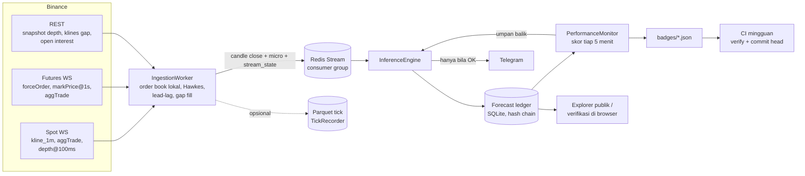
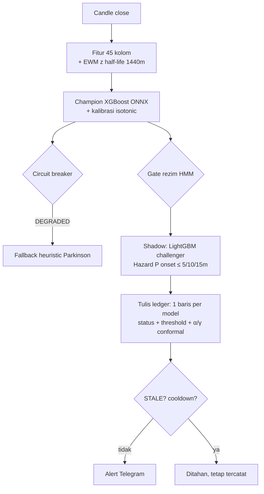

# Crypto Volatility Predictor (BTCUSDT)

**Angka live:**  · median lead time live ada di [`badges/champion_xgboost_metrics.json`](badges/) dan di halaman ledger. Badge ini dihitung mingguan dari [forecast ledger](#forecast-ledger) publik dan **belum berisi data**: service belum berjalan di pasar nyata. Satu-satunya angka yang ada sekarang berasal dari data **sintetis**: PR-AUC holdout 0.610 (14.8× base rate 4.1%) dengan median lead time 40 menit, dan pada data yang sama baseline GARCH(1,1) lebih baik (PR-AUC 0.755).

[](.github/workflows/ci.yml)
[](.github/workflows/drift_check.yml)


> Ganti `OWNER/REPO` dengan repo GitHub kamu setelah push.

Sistem ini memprediksi apakah volatilitas Parkinson BTCUSDT 15 menit ke depan akan lebih dari 2 standar deviasi di atas riwayat 30 harinya sendiri, lalu mengirim alert Telegram. Setiap prediksi dicatat di ledger berantai hash **sebelum** hasilnya diketahui, lalu diskor otomatis, sehingga performa live bisa diverifikasi siapa saja.

## Isi

- [Arsitektur](#arsitektur)
- [Target yang diprediksi](#target-yang-diprediksi)
- [Hasil evaluasi (data sintetis)](#hasil-evaluasi-data-sintetis)
- [Latency terukur](#latency-terukur)
- [Forecast ledger](#forecast-ledger)
- [Keandalan: breaker, replay, chaos](#keandalan)
- [Menjalankan](#menjalankan)
- [Yang belum terbukti dan perlu lingkungan live](#yang-belum-terbukti)
- [Extras: lampu ESP32](#extras-lampu-esp32)

## Arsitektur



Per candle 1 menit yang close, engine menjalankan langkah ini berurutan:



| Komponen | File | Diuji di |
|---|---|---|
| Target & baseline 30 hari (hanya masa lalu) | `app/ml/target.py` | `tests/test_target.py` |
| Order book lokal (diff depth + snapshot, aturan sinkronisasi Binance) | `ingestion/orderbook.py` | `test_orderbook.py`, `test_orderbook_parity.py` (vs hftbacktest) |
| Futures: likuidasi, mark price, basis, funding, open interest | `ingestion/futures_feed.py` | `test_chaos.py` |
| Hawkes 2 dimensi (transaksi besar ≥ $100k, likuidasi), update O(1) | `app/hawkes.py` | `test_hawkes.py` |
| Lead-lag perp → spot | `ingestion/leadlag.py` | `test_models_extra.py` |
| Circuit breaker OK / DEGRADED / STALE | `app/core/circuit_breaker.py` | `test_reliability.py`, `test_chaos.py` |
| Normalisasi EWM online (state di Redis) | `app/normalize.py` | `test_parity.py` |
| Kalibrasi isotonic | `app/calibration.py` | `test_models_extra.py` |
| Threshold adaptif (ACI) | `app/conformal.py` | `test_models_extra.py` |
| Hazard diskrit P(onset ≤ k) | `app/hazard.py` | `test_models_extra.py` |
| Forecast ledger | `app/services/ledger.py` | `test_ledger.py`, `test_explorer.py`, `test_scripts.py` |
| Rekaman tick & replay deterministik | `app/services/recorder.py`, `app/services/replay.py` | `test_recorder.py`, `test_replay.py` |

## Target yang diprediksi

> Dalam 15 menit ke depan, apakah log volatilitas Parkinson BTCUSDT akan lebih dari 2 sd di atas baseline 30 harinya (yang hanya memakai data masa lalu)?

Threshold label (Z > 2) **terpisah** dari threshold probabilitas alert. Threshold alert dipilih dari kurva precision-recall fold validasi (recall maksimum dengan precision ≥ 0.5), disimpan di `models/metadata.json`, dan dicatat di setiap baris ledger. Pesan Telegram tidak menyebut Z-score sama sekali. Detail: [`docs/target_and_ledger.md`](docs/target_and_ledger.md).

## Hasil evaluasi (data sintetis)

> ⚠️ Lingkungan build tidak bisa mengakses Binance, jadi semua angka di bagian ini dari data **sintetis** 60 hari (`training/synthetic.py`). Angka ini membuktikan pipeline evaluasinya berjalan, **bukan** performa pasar. Latih ulang dengan `python -m training.train --source binance --days 90`; laporan lengkap ada di [`reports/EVALUATION.md`](reports/EVALUATION.md).

Split waktu train / val / holdout = 48,367 / 12,156 / 15,259 menit, dipisah 255 menit (= horizon 15 + lookback fitur 240, dihitung oleh `TargetSpec.min_embargo`, diuji di `tests/test_purged_cv.py`). Model hanya dilatih di train; kalibrasi dan threshold dipilih di val; semua angka di bawah dari holdout.

### Perbandingan dengan baseline sederhana

Threshold tiap model dipilih di val dengan aturan yang sama. Lead time memakai definisi yang sama dengan skor ledger live.

| Model | PR-AUC | Lift vs acak | ROC-AUC | Brier | Median lead time |
|---|---|---|---|---|---|
| GARCH(1,1) | **0.755** | 18.3× | 0.961 | 0.0180 | 45.0 mnt (23/23 episode) |
| Persistence (vol sekarang berlanjut) | 0.736 | 17.9× | 0.957 | 0.0187 | 45.0 mnt (23/23 episode) |
| HAR-RV (15m/1j/1h) | 0.732 | 17.8× | 0.957 | 0.0188 | 45.0 mnt (23/23 episode) |
| LightGBM (challenger) | 0.650 | 15.8× | 0.950 | 0.0278 | 43.0 mnt (23/23 episode) |
| **XGBoost (champion, isotonic)** | 0.610 | 14.8× | 0.949 | 0.0238 | 40.0 mnt (22/23 episode) |
| Hazard P(onset ≤ 15m) | 0.539 | 13.1× | 0.955 | 0.0266 | 45.0 mnt (23/23 episode) |

**XGBoost kalah dari ketiga baseline sederhana di data ini.** Generator sintetis memakai rezim volatilitas Markov dengan persistensi tinggi, jadi model yang hanya melihat volatilitas sekarang memang unggul. Kalau hal yang sama terjadi di data Binance, champion sebaiknya diganti GARCH/HAR sampai ada fitur yang terbukti menambah nilai.

### Ablation kelompok fitur

| Kelompok dibuang | ΔPR-AUC | Δ median lead | Kesimpulan |
|---|---|---|---|
| VPIN | −0.0107 | −2.0 mnt | berkontribusi |
| SWT (wavelet) | +0.0017 | 0.0 mnt | tidak berkontribusi, kandidat dibuang (`--apply-ablation`) |
| OBI order book, Hawkes, lead-lag, funding/OI | n/a | n/a | fitur live-only: belum ada histori tick untuk melatihnya |

Fitur live-only dihitung dan dicatat (`/micro/BTCUSDT`, rekaman Parquet) tetapi **tidak** masuk model sampai ada ≥ beberapa minggu rekaman dan ablation membuktikannya.

### Kalibrasi, hazard, threshold adaptif

- **Isotonic** (dilatih di val): Brier holdout 0.02773 → **0.02379**. Reliability diagram: [`reports/figures/reliability.png`](reports/figures/reliability.png).
- **Hazard** P(onset ≤ 5/10/15m): PR-AUC 0.545 / 0.542 / 0.539, monoton naik secara konstruksi. Lebih buruk dari model biner di PR-AUC (0.539 vs 0.610), lebih baik di lead time (45 vs 40 menit). Dipakai untuk informasi "kapan" di pesan alert, bukan untuk memicu alert.
- **Adaptive conformal (ACI)**, target porsi alert palsu 20%, γ = 0.01:

| Skenario holdout | Alert palsu threshold statis | Alert palsu ACI |
|---|---|---|
| Apa adanya | 0.60 | **0.35** |
| Pergantian rezim (logit +1.5 di paruh kedua) | 0.80 | **0.37** |

ACI jauh lebih baik dari threshold statis saat rezim berganti, tetapi **belum mencapai target 20%** dengan γ = 0.01 di holdout ini. γ dan target tercatat di setiap baris ledger dan bisa diubah lewat `/setalpha` atau `CONFORMAL_GAMMA`.

### Purged walk-forward CV

PR-AUC per fold 0.565 / 0.598 / 0.604 / 0.653 / 0.790, rata-rata 0.642.

## Latency terukur

`python -m bench.bench_pipeline --minutes 120` memutar 66,140 pesan WebSocket sintetis lewat jalur produksi (Intel Xeon 2.1 GHz, 4 core, Python 3.13, Redis in-process). Laporan: [`reports/benchmark.md`](reports/benchmark.md).

| Tahap (per candle close) | p50 | p95 | p99 |
|---|---|---|---|
| Fitur (240 menit + EWM z) | 27.2 ms | 37.1 ms | 43.0 ms |
| Champion ONNX + isotonic | 1.20 ms | 1.42 ms | 1.52 ms |
| Challenger LightGBM | 1.02 ms | 1.26 ms | 2.17 ms |
| Hazard XGBoost | 0.95 ms | 1.23 ms | 1.29 ms |
| Tulis ledger (SHA-256 + SQLite) | 2.27 ms | 3.14 ms | 5.92 ms |
| **Kline close diterima → keputusan selesai** | **39.4 ms** | **52.7 ms** | **68.1 ms** |

| Per pesan WebSocket | p50 | p99 |
|---|---|---|
| `depth` (update order book lokal) | 0.10 ms | 0.40 ms |
| `aggTrade` | 0.004 ms | 0.043 ms |

Tahap terberat adalah fitur, bukan model. Di produksi tambahkan RTT Redis (lokal ~0.2–1 ms, Upstash ~5–20 ms) dan waktu kirim Telegram. CI menjalankan benchmark ini di setiap push dan menaruh tabelnya di ringkasan job.

## Forecast ledger

- **Append-only**: trigger SQLite menolak UPDATE/DELETE.
- **Hash chain**: `row_hash = sha256(prev_hash + JSON kanonik)`, termasuk status breaker, threshold yang berlaku, dan α/γ conformal.
- **Tidak bisa dicatat terlambat**: baris ditolak bila ditulis > 60 detik setelah waktu keputusan.
- **Baseline dibekukan**: skor memakai μ/σ yang tersimpan di baris itu.
- Champion, challenger, dan hazard mencatat di keputusan yang sama, jadi perbandingan shadow adil.

Verifikasi tanpa mempercayai server:

1. **Browser**: buka `/` (explorer) lalu tekan *Verifikasi di browser*. Halaman mengunduh `/ledger/rows` dan menghitung ulang semua hash (SubtleCrypto, fallback JS murni). Hash JS dicocokkan dengan Python di `tests/test_explorer.py`. Kolom "Cek ada di rantai" menerima head lama dari git untuk membuktikan riwayat tidak ditulis ulang.
2. **Terminal**: `python -m scripts.verify_ledger --url https://<host> --anchor badges/ledger_head.txt`.
3. **CI mingguan** ([`drift_check.yml`](.github/workflows/drift_check.yml)): langkah 2, job merah dan issue dibuka bila rantai putus atau head minggu lalu hilang; kalau lolos, commit `badges/*.json` + `ledger_head.txt`. PSI drift fitur (ambang 0.2) opsional lewat `vars.PSI_CHECK`.

Halaman explorer juga menampilkan metrik per model (PR-AUC, lift, precision, recall, lead time), prediksi terbaru beserta hasilnya, dan tautan halaman insiden.

### Halaman insiden

`python -m scripts.build_incident --event all` membangun halaman untuk COVID 2020-03-12, larangan kripto China 2021-05-19, LUNA 2022-05, FTX 2022-11-08, dan yen carry 2024-08-05: harga, RV 15m, intensitas Hawkes (transaksi besar dari arsip aggTrades, likuidasi bila arsipnya ada), P(spike), P(≤5/10/15m), waktu alert, episode spike, dan lead time. Butuh akses Binance, jadi **belum dibangun di repo ini**. Yang ada sekarang adalah 3 contoh dari data sintetis (`--demo`, berlabel jelas) di [`reports/incidents/`](reports/incidents/).

## Keandalan

| Mekanisme | Bukti |
|---|---|
| Breaker **STALE** bila stream wajib (kline, aggTrade, depth) lebih tua dari 5 detik, atau baru pulih < 30 detik: alert ditahan, prediksi tetap dicatat dengan `status=STALE` | `test_chaos.py::test_ws_down_30s_*` |
| Breaker **DEGRADED** bila model/fitur gagal atau timeout: fallback heuristic Parkinson, baris ledger `fallback_parkinson` berstatus DEGRADED | `test_degraded.py` |
| Gap aggTrade/kline diisi dari REST, order book resync otomatis bila update hilang | `test_chaos.py` (reconnect harian, depth hilang) |
| Redis restart / API restart: state baseline, EWM, conformal, cooldown dimuat ulang; pesan menggantung diambil lagi (XAUTOCLAIM) | `test_chaos.py` |
| Replay deterministik: dua replay atas rekaman yang sama → ledger byte-identik | `test_replay.py` |
| Fitur training == fitur live (batch vs streaming) | `test_parity.py` |
| Order book lokal == hftbacktest (best bid/ask + qty per level) | `test_orderbook_parity.py` |
| Command Telegram pengubah state hanya dari `ALLOWED_CHAT_IDS`, ditolak & dicatat dari chat lain, nilai divalidasi 0 < p < 1 | `test_reliability.py` |

Status breaker ada di `/health` (`breaker_state`) dan `/metrics` (`cvp_breaker_state` untuk Prometheus).

## Menjalankan

```bash
cp .env.example .env            # isi TELEGRAM_BOT_TOKEN, TELEGRAM_CHAT_ID, ALLOWED_CHAT_IDS, ADMIN_API_TOKEN
docker compose up --build       # Redis (AOF) + ingestion + API; explorer di http://localhost:8000
```

Tanpa Docker (Python 3.12):

```bash
pip install -r requirements-dev.txt
python -m training.train --source binance --days 90     # atau --source synthetic untuk demo offline
redis-server &                                          # atau REDIS_URL ke Upstash
python -m ingestion.worker &
uvicorn app.main:app --port 8000
pytest -q                                               # 74 test, ~70 detik
```

**Windows** (tanpa Docker): pakai Python 3.12, set `PYTHONUTF8=1` (laporan berisi karakter seperti ≤ dan →), dan jalankan Redis lewat Docker Desktop, WSL (`sudo apt install redis-server`), atau Upstash gratis (`REDIS_URL=rediss://...`).

Alat lain:

| Perintah | Fungsi |
|---|---|
| `RECORD_TICKS=true` | rekam semua pesan mentah ke Parquet (`data/ticks/stream/YYYY-MM-DD/HH/`) |
| `python -m app.services.replay --ticks data/ticks --history hist.csv` | replay deterministik rekaman lewat jalur produksi |
| `python -m scripts.fit_hawkes --ticks data/ticks` | fit parameter Hawkes mingguan (MLE) |
| `python -m scripts.leadlag_report --ticks data/ticks` | ukur berapa detik perp memimpin spot → `reports/leadlag.md` |
| `python -m scripts.build_incident --event ftx` | bangun ulang satu halaman insiden |
| `python -m scripts.psi_drift --url https://<host>` | PSI fitur live vs data train |
| `python -m bench.bench_pipeline` | benchmark latency |

Endpoint utama: `/` explorer, `/ledger/rows`, `/ledger/head`, `/ledger/verify`, `/performance`, `/health`, `/metrics`, `/status`, `/predict` (manual, tidak dicatat di ledger), `PUT /config/threshold` (butuh `X-Admin-Token`). Dokumentasi lengkap di `/docs`.

**Deploy gratis (Render)**: [`render.yaml`](render.yaml) menjalankan semua di satu web service. Disk Render gratis **tidak persisten**, jadi ledger SQLite hilang saat redeploy; untuk ledger yang bisa diaudit pakai persistent disk (berbayar) atau VPS, dan biarkan CI mingguan meng-commit head ke git.

## Yang belum terbukti

Hal-hal ini butuh koneksi ke Binance dan waktu berjalan, jadi belum ada angkanya:

- **Performa pasar nyata**: badge live di atas, setelah service berjalan ≥ 1 minggu.
- **Rekaman 24 jam** + `check_continuity` tanpa gap, lalu parity order book vs hftbacktest atas rekaman itu (sekarang diuji atas 15 menit tick sintetis).
- **Lag perp → spot nyata**: [`reports/leadlag.md`](reports/leadlag.md) sekarang dari data sintetis yang sengaja dibuat perp memimpin 2 detik; ini hanya membuktikan pengukurannya bekerja.
- **Hawkes** di-fit dari data nyata (`models/hawkes_params.json` sekarang parameter default).
- **Halaman insiden** untuk 5 peristiwa nyata.
- Stream futures `fstream.binance.com` diblokir dari IP AS (HTTP 451); di server AS fitur futures kosong dan breaker tidak mewajibkannya.

Sengaja tidak dikerjakan: clone penuh hftbacktest/NautilusTrader, exchange atau simbol selain BTCUSDT, dan deep learning sebelum baseline dan ablation selesai di data nyata.

## Extras: lampu ESP32

[`firmware/`](firmware/) berisi sketch Arduino ESP32 + diagram Wokwi: LED hijau/kuning/merah dan buzzer mengikuti P(spike) terhadap threshold dari `GET /status`, dan berkedip saat sistem STALE/DEGRADED. Ini pelengkap, bukan bagian dari sistem yang diukur di atas.
