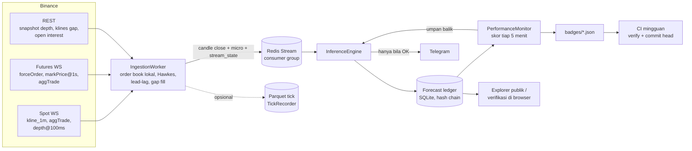
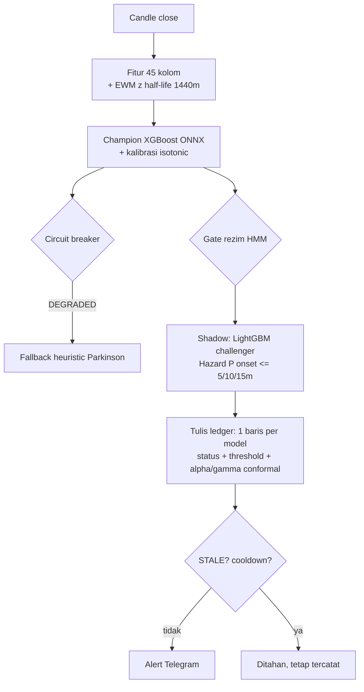

# Crypto Volatility Predictor (BTCUSDT)

[](.github/workflows/ci.yml)

Layanan prediksi lonjakan volatilitas Parkinson BTCUSDT untuk horizon 15 menit ke depan dengan notifikasi Telegram. Setiap prediksi dicatat ke dalam [forecast ledger](#forecast-ledger) berantai hash sebelum hasil aktualnya terbentuk dan diskor secara otomatis setiap 5 menit.

> **Status metrik:** Badge live di atas diperbarui mingguan dari ledger publik (detail metrik ada di [`badges/`](badges/)). Karena layanan belum dijalankan terus-menerus di pasar live, angka evaluasi di bawah berasal dari pengujian pada data **sintetis** 60 hari: PR-AUC holdout **0.610** (14.8x *base rate* 4.1%, median *lead time* 40 menit), sedangkan baseline GARCH(1,1) mencapai PR-AUC **0.755** pada dataset yang sama.

## Arsitektur



Alur eksekusi pada setiap penutupan candle 1 menit:



| Komponen | Lokasi File | Pengujian |
|---|---|---|
| Target & baseline 30 hari (strictly past) | `app/ml/target.py` | `tests/test_target.py` |
| Order book lokal (diff depth + snapshot Binance) | `ingestion/orderbook.py` | `test_orderbook.py`, `test_orderbook_parity.py` |
| Futures (likuidasi, mark price, basis, funding, OI) | `ingestion/futures_feed.py` | `test_chaos.py` |
| Proses Hawkes 2D (transaksi >= $100k, likuidasi), update O(1) | `app/hawkes.py` | `test_hawkes.py` |
| Lead-lag perpetual -> spot | `ingestion/leadlag.py` | `test_models_extra.py` |
| Circuit breaker (`OK` / `DEGRADED` / `STALE`) | `app/core/circuit_breaker.py` | `test_reliability.py`, `test_chaos.py` |
| Normalisasi EWM online (state di Redis) | `app/normalize.py` | `test_parity.py` |
| Kalibrasi isotonic | `app/calibration.py` | `test_models_extra.py` |
| Threshold adaptif (ACI) | `app/conformal.py` | `test_models_extra.py` |
| Hazard diskrit `P(onset <= k)` | `app/hazard.py` | `test_models_extra.py` |
| Forecast ledger | `app/services/ledger.py` | `test_ledger.py`, `test_explorer.py`, `test_scripts.py` |
| Perekam tick & replay deterministik | `app/services/recorder.py`, `app/services/replay.py` | `test_recorder.py`, `test_replay.py` |

## Target Prediksi

Model memprediksi apakah log volatilitas Parkinson BTCUSDT dalam 15 menit ke depan akan melampaui **2 standar deviasi** di atas baseline historis 30 hari (hanya menggunakan data masa lalu).

Threshold label (`Z > 2`) dipisahkan dari threshold probabilitas alert. Threshold alert dipilih dari kurva *precision-recall* pada fold validasi (memaksimalkan *recall* dengan syarat *precision* >= 0.5), disimpan di `models/metadata.json`, dan dicatat pada setiap baris ledger. Detail spesifikasi ada di [`docs/target_and_ledger.md`](docs/target_and_ledger.md).

## Evaluasi (Data Sintetis)

Karena proses build CI berjalan tanpa akses jaringan ke Binance, angka di bawah dihasilkan dari generator data sintetis 60 hari (`training/synthetic.py`) untuk memverifikasi pipeline evaluasi. Untuk melatih ulang dengan data historis pasar nyata, jalankan `python -m training.train --source binance --days 90`. Laporan lengkap tersedia di [`reports/EVALUATION.md`](reports/EVALUATION.md).

Pembagian waktu train / val / holdout adalah **48,367 / 12,156 / 15,259 menit** dengan jarak *embargo* 255 menit (horizon 15 menit + *lookback* fitur 240 menit via `TargetSpec.min_embargo`, diverifikasi di `tests/test_purged_cv.py`).

### Perbandingan Baseline

| Model | PR-AUC | Lift vs Acak | ROC-AUC | Brier | Median Lead Time |
|---|---|---|---|---|---|
| GARCH(1,1) | **0.755** | 18.3x | 0.961 | 0.0180 | 45.0 mnt (23/23 episode) |
| Persistence | 0.736 | 17.9x | 0.957 | 0.0187 | 45.0 mnt (23/23 episode) |
| HAR-RV (15m/1j/1h) | 0.732 | 17.8x | 0.957 | 0.0188 | 45.0 mnt (23/23 episode) |
| LightGBM (challenger) | 0.650 | 15.8x | 0.950 | 0.0278 | 43.0 mnt (23/23 episode) |
| **XGBoost (champion, isotonic)** | 0.610 | 14.8x | 0.949 | 0.0238 | 40.0 mnt (22/23 episode) |
| Hazard `P(onset <= 15m)` | 0.539 | 13.1x | 0.955 | 0.0266 | 45.0 mnt (23/23 episode) |

Pada data sintetis berbasis Markov dengan persistensi tinggi ini, model baseline yang mengandalkan volatilitas terkini mengungguli XGBoost. Jika pola yang sama muncul pada data Binance aktual, model champion dapat diganti ke GARCH/HAR sebelum fitur mikrostruktur tambahan diaktifkan.

### Ablation Fitur

| Kelompok Fitur | ΔPR-AUC | Δ Median Lead | Catatan |
|---|---|---|---|
| VPIN | -0.0107 | -2.0 mnt | Berkontribusi positif |
| SWT (wavelet) | +0.0017 | 0.0 mnt | Tidak signifikan, opsi hapus via `--apply-ablation` |
| OBI order book, Hawkes, lead-lag, funding/OI | n/a | n/a | Khusus mode live (belum masuk training karena butuh histori tick) |

### Kalibrasi, Hazard, dan Threshold Adaptif

- **Kalibrasi isotonic:** Menurunkan skor Brier pada holdout dari `0.02773` menjadi `0.02379`. Diagram keandalan tersedia di [`reports/figures/reliability.png`](reports/figures/reliability.png).
- **Model hazard `P(onset <= 5/10/15m)`:** Menghasilkan PR-AUC `0.545 / 0.542 / 0.539` dengan median *lead time* 45 menit; digunakan sebagai informasi estimasi waktu kejadian di pesan alert.
- **Adaptive Conformal Inference (ACI):** Dengan target *false alert* 20% (`gamma = 0.01`):

| Skenario Holdout | False Alert (Threshold Statis) | False Alert (ACI) |
|---|---|---|
| Normal | 0.60 | **0.35** |
| Pergantian rezim (logit +1.5 pada paruh kedua) | 0.80 | **0.37** |

- **Purged walk-forward CV:** PR-AUC per fold `0.565 / 0.598 / 0.604 / 0.653 / 0.790` (rata-rata **0.642**).

## Benchmark Latency

Hasil eksekusi `python -m bench.bench_pipeline --minutes 120` untuk memproses 66,140 pesan WebSocket sintetis (Intel Xeon 2.1 GHz, 4 core, Python 3.13, Redis in-process). Detail ada di [`reports/benchmark.md`](reports/benchmark.md).

| Tahap (per candle close) | p50 | p95 | p99 |
|---|---|---|---|
| Ekstraksi fitur (240 menit + EWM z) | 27.2 ms | 37.1 ms | 43.0 ms |
| Champion ONNX + isotonic | 1.20 ms | 1.42 ms | 1.52 ms |
| Challenger LightGBM | 1.02 ms | 1.26 ms | 2.17 ms |
| Hazard XGBoost | 0.95 ms | 1.23 ms | 1.29 ms |
| Tulis ledger (SHA-256 + SQLite) | 2.27 ms | 3.14 ms | 5.92 ms |
| **Total (kline close -> keputusan)** | **39.4 ms** | **52.7 ms** | **68.1 ms** |

| Per pesan WebSocket | p50 | p99 |
|---|---|---|
| `depth` (update order book lokal) | 0.10 ms | 0.40 ms |
| `aggTrade` | 0.004 ms | 0.043 ms |

## Forecast Ledger

- **Append-only:** Trigger SQLite memblokir operasi `UPDATE` dan `DELETE`.
- **Hash chain:** `row_hash = sha256(prev_hash + JSON kanonik)`, mencakup status breaker, threshold aktif, dan parameter conformal (`alpha`/`gamma`).
- **Batas waktu pencatatan:** Baris ditolak apabila ditulis lebih dari 60 detik setelah waktu keputusan.
- **Frozen baseline:** Evaluasi skor memakai nilai `mu` dan `sigma` yang tersimpan pada saat prediksi dibuat.

Verifikasi integritas ledger dapat dilakukan melalui tiga cara:

1. **Browser:** Buka halaman utama `/` (explorer) dan klik *Verifikasi di browser* untuk menghitung ulang seluruh rantai hash via SubtleCrypto.
2. **CLI:** Jalankan `python -m scripts.verify_ledger --url https://<host> --anchor badges/ledger_head.txt`.
3. **CI mingguan:** Workflow [`drift_check.yml`](.github/workflows/drift_check.yml) memverifikasi rantai hash secara berkala, membuka issue jika rantai terputus, dan memperbarui `badges/*.json` serta `ledger_head.txt`.

### Simulasi Insiden Historis

Perintah `python -m scripts.build_incident --event all` membangun halaman analisis untuk 5 peristiwa volatilitas ekstrem (COVID 2020-03-12, larangan kripto China 2021-05-19, LUNA 2022-05, FTX 2022-11-08, dan *yen carry* 2024-08-05). Karena pengunduhan arsip historis membutuhkan koneksi langsung ke Binance, saat ini repositori menyertakan 3 contoh hasil generasi sintetis (`--demo`) di [`reports/incidents/`](reports/incidents/).

## Keandalan Sistem

| Mekanisme | Pengujian |
|---|---|
| Breaker **STALE** jika stream wajib (`kline`, `aggTrade`, `depth`) tertinggal > 5 detik atau baru pulih < 30 detik; alert ditahan tetapi prediksi tetap dicatat | `test_chaos.py` |
| Breaker **DEGRADED** saat inferensi model/fitur gagal atau timeout; sistem beralih ke heuristik Parkinson | `test_degraded.py` |
| Pengisian celah `aggTrade`/`kline` via REST dan resync otomatis order book saat urutan update terputus | `test_chaos.py` |
| Pemulihan state otomatis (baseline, EWM, conformal, cooldown) dan klaim pesan menggantung (`XAUTOCLAIM`) setelah restart Redis/API | `test_chaos.py` |
| Replay deterministik atas rekaman Parquet menghasilkan ledger *byte-identical* | `test_replay.py` |
| Konsistensi fitur batch (training) vs streaming (live) serta paritas order book terhadap `hftbacktest` | `test_parity.py`, `test_orderbook_parity.py` |
| Validasi perintah Telegram hanya dari `ALLOWED_CHAT_IDS` dengan batas parameter `0 < p < 1` | `test_reliability.py` |

Status breaker dipublikasikan di endpoint `/health` (`breaker_state`) dan `/metrics` (`cvp_breaker_state`).

## Cara Menjalankan

### Menggunakan Docker

```bash
cp .env.example .env        # isi TELEGRAM_BOT_TOKEN, TELEGRAM_CHAT_ID, ALLOWED_CHAT_IDS, ADMIN_API_TOKEN
docker compose up --build   # menjalankan Redis (AOF), ingestion worker, dan API di http://localhost:8000
```

### Tanpa Docker (Python 3.12+)

```bash
pip install -r requirements-dev.txt
python -m training.train --source binance --days 90   # gunakan --source synthetic untuk mode offline
redis-server &                                        # atau arahkan REDIS_URL ke Upstash
python -m ingestion.worker &
uvicorn app.main:app --port 8000
pytest -q
```

**Catatan Windows:** Set variabel environment `PYTHONUTF8=1` sebelum menjalankan skrip laporan, dan jalankan Redis melalui Docker Desktop, WSL, atau layanan cloud seperti Upstash (`REDIS_URL=rediss://...`).

### Utilitas CLI Tambahan

| Perintah | Kegunaan |
|---|---|
| `RECORD_TICKS=true` | Merekam stream mentah ke format Parquet (`data/ticks/stream/YYYY-MM-DD/HH/`) |
| `python -m app.services.replay --ticks data/ticks --history hist.csv` | Menjalankan replay deterministik dari rekaman tick |
| `python -m scripts.fit_hawkes --ticks data/ticks` | Estimasi parameter Hawkes (MLE) dari data rekaman |
| `python -m scripts.leadlag_report --ticks data/ticks` | Analisis jeda waktu perpetual terhadap spot -> [`reports/leadlag.md`](reports/leadlag.md) |
| `python -m scripts.build_incident --event ftx` | Membuat halaman insiden tunggal |
| `python -m scripts.psi_drift --url https://<host>` | Menghitung PSI drift fitur live terhadap data latih |
| `python -m bench.bench_pipeline` | Menjalankan benchmark latency pipeline |

**Endpoint API:** `/` (explorer), `/ledger/rows`, `/ledger/head`, `/ledger/verify`, `/performance`, `/health`, `/metrics`, `/status`, `/predict`, serta `PUT /config/threshold` (memerlukan header `X-Admin-Token`). Dokumentasi interaktif tersedia di `/docs` saat server berjalan.

**Deploy Render:** Konfigurasi di [`render.yaml`](render.yaml) menjalankan seluruh komponen dalam satu layanan web. Untuk deployment produksi yang membutuhkan persistensi ledger SQLite saat redeploy, gunakan *persistent disk* atau VPS.

## Batasan & Tahap Selanjutnya

- Mengumpulkan rekaman live minimal 1 minggu untuk mengisi data badge publik dan memvalidasi paritas order book pada kondisi pasar aktual.
- Melakukan *fitting* ulang parameter Hawkes (`models/hawkes_params.json`) dan pengukuran *lead-lag* menggunakan rekaman tick asli (saat ini [`reports/leadlag.md`](reports/leadlag.md) masih memakai data sintetis dengan lag buatan 2 detik).
- Membangun halaman insiden dari arsip historis Binance aktual.
- Endpoint futures `fstream.binance.com` mengembalikan HTTP 451 dari IP server Amerika Serikat; pada region tersebut fitur futures dinonaktifkan otomatis tanpa memicu status breaker.

## Integrasi Perangkat Keras (ESP32)

Direktori [`firmware/`](firmware/) berisi *sketch* Arduino ESP32 dan simulasi Wokwi untuk indikator fisik menggunakan LED (hijau/kuning/merah) dan buzzer berdasarkan nilai probabilitas terhadap threshold dari endpoint `GET /status`.