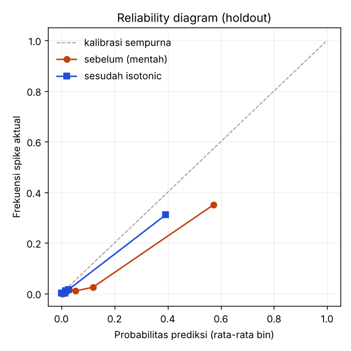

# Evaluasi model volatility spike

- Dilatih 2026-11-07T07:44:59+00:00 · sumber data **synthetic** · simbol BTCUSDT
- Label: log-Parkinson vol 15 menit ke depan > 2.0 sd di atas baseline 30 hari (hanya masa lalu, `app/ml/target.py`). Threshold label ini TERPISAH dari threshold probabilitas alert.
- Split waktu train / val / holdout = 48,367 / 12,156 / 15,259 baris, jarak antar bagian 255 menit (TargetSpec.min_embargo(240) = H + 240).

## Ringkasan holdout

PR-AUC **0.610** vs base rate 0.041 (lift 14.8x) · median lead time **40.0 mnt (22/23 episode)** · ROC-AUC 0.949

Threshold alert **0.0714**, dipilih di fold validasi: recall maksimum dengan precision >= 0.5 (val precision 0.56, recall 0.87). Di holdout: precision 0.40, recall 0.83 (TP 523, FP 794, FN 105, TN 13,837).

## Perbandingan dengan baseline (roadmap 2.5)

Semua model memakai holdout yang sama; threshold masing-masing dipilih di fold validasi dengan aturan yang sama.

| Model | PR-AUC | Lift vs acak | ROC-AUC | Brier | Median lead time @ threshold val |
|---|---|---|---|---|---|
| GARCH(1,1) | 0.755 | 18.3x | 0.961 | 0.0180 | 45.0 mnt (23/23 episode) |
| Persistence (vol sekarang berlanjut) | 0.736 | 17.9x | 0.957 | 0.0187 | 45.0 mnt (23/23 episode) |
| HAR-RV (15m/1j/1h) | 0.732 | 17.8x | 0.957 | 0.0188 | 45.0 mnt (23/23 episode) |
| LightGBM (challenger) | 0.650 | 15.8x | 0.950 | 0.0278 | 43.0 mnt (23/23 episode) |
| XGBoost (champion, isotonic) | 0.610 | 14.8x | 0.949 | 0.0238 | 40.0 mnt (22/23 episode) |
| Hazard P(onset ≤ 15m) | 0.539 | 13.1x | 0.955 | 0.0266 | 45.0 mnt (23/23 episode) |

## Kalibrasi isotonic (roadmap 4.2)

Brier score holdout: sebelum **0.02773** → sesudah **0.02379**. Kalibrator dilatih di fold validasi (bukan holdout).

## Hazard: P(spike mulai ≤ 5/10/15 menit) (roadmap 2.6)

| Horizon | PR-AUC | Base rate |
|---|---|---|
| ≤5 menit | 0.545 | 0.0412 |
| ≤10 menit | 0.542 | 0.0412 |
| ≤15 menit | 0.539 | 0.0412 |

P(≤k) = 1 − Π(1 − h_j) sehingga monoton naik di k secara konstruksi (diuji).

- PR-AUC P(≤15) 0.539 vs model biner 0.610 → LEBIH BURUK ❌
- Median lead time hazard 45.0 mnt (23/23 episode) vs biner 40.0 mnt (22/23 episode) → lebih baik ✅
- MAE menit onset 2.80 vs tebakan naif tengah horizon 3.78

## Adaptive conformal vs threshold statis (roadmap 4.1, target alarm palsu 20%)

Metrik: porsi alert yang ternyata bukan spike. Umpan balik tertunda H menit seperti live.

| Skenario | Kuartal | Alarm palsu statis | Alarm palsu ACI | Alert statis | Alert ACI | Recall statis | Recall ACI |
|---|---|---|---|---|---|---|---|
| Holdout apa adanya | Q1 | 0.50 | 0.34 | 495 | 359 | 0.82 | 0.78 |
| Holdout apa adanya | Q2 | 0.97 | 0.94 | 160 | 18 | 0.25 | 0.06 |
| Holdout apa adanya | Q3 | 0.58 | 0.41 | 177 | 71 | 0.82 | 0.46 |
| Holdout apa adanya | Q4 | 0.60 | 0.24 | 485 | 98 | 0.89 | 0.34 |
| Holdout apa adanya | **Total** | **0.60** | **0.35** | | | | |
| Pergantian rezim (logit +1.5 di paruh 2) | Q1 | 0.50 | 0.34 | 495 | 359 | 0.82 | 0.78 |
| Pergantian rezim (logit +1.5 di paruh 2) | Q2 | 0.97 | 0.94 | 160 | 18 | 0.25 | 0.06 |
| Pergantian rezim (logit +1.5 di paruh 2) | Q3 | 0.88 | 0.41 | 708 | 105 | 0.93 | 0.67 |
| Pergantian rezim (logit +1.5 di paruh 2) | Q4 | 0.85 | 0.30 | 1396 | 107 | 0.95 | 0.34 |
| Pergantian rezim (logit +1.5 di paruh 2) | **Total** | **0.80** | **0.37** | | | | |

## Ablation kelompok fitur (roadmap 2.7)

| Kelompok fitur dibuang | ΔPR-AUC | Δ median lead (menit) | Kesimpulan |
|---|---|---|---|
| VPIN | -0.0107 | -2.0 | berkontribusi |
| SWT (wavelet) | +0.0017 | +0.0 | tidak berkontribusi -> kandidat dibuang |
| OBI (order book) | n/a | n/a | n/a (fitur live-only, belum ada histori) |
| Hawkes | n/a | n/a | n/a (fitur live-only, belum ada histori) |
| Lead-lag perp→spot | n/a | n/a | n/a (fitur live-only, belum ada histori) |
| Funding/OI | n/a | n/a | n/a (fitur live-only, belum ada histori) |

## Purged walk-forward CV

| Fold | Train | Test | PR-AUC | Base rate |
|---|---|---|---|---|
| 1 | 9,874 | 10,129 | 0.565 | 0.0871 |
| 2 | 20,003 | 10,129 | 0.598 | 0.0445 |
| 3 | 30,132 | 10,129 | 0.604 | 0.0426 |
| 4 | 40,261 | 10,129 | 0.653 | 0.0474 |
| 5 | 50,390 | 10,133 | 0.790 | 0.0994 |
| **Rata-rata** | | | **0.642** | |

## Gate rezim HMM

| Gate | Model dipanggil | Precision | Recall | Median lead |
|---|---|---|---|---|
| off | 100% | 0.40 | 0.83 | 40.0 mnt (22/23 episode) |
| high | 39% | 0.40 | 0.83 | 40.0 mnt (22/23 episode) |

> ⚠️ Data **sintetis** (lingkungan build tidak bisa mengakses Binance). Angka di atas membuktikan pipeline berjalan, BUKAN performa pasar nyata. Latih ulang dengan `--source binance`.
